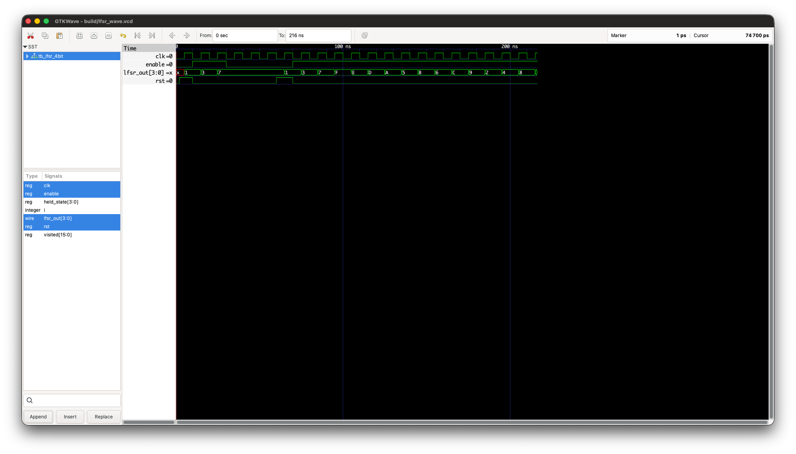

# 4-bit LFSR Pseudorandom Sequence Generator

A small Verilog RTL project implementing a 4-bit Linear Feedback Shift Register (LFSR), with synchronous reset, enable control, a self-checking testbench, and a verified 15-state nonzero cycle. No physical hardware is required.

An LFSR stores a state, shifts its bits, and feeds an XOR of selected bits back into the register. Given the same seed and enabled clock edges, it always produces the same sequence.

## Design

- Language: Verilog-2001; simulation uses Icarus Verilog's `-g2005` mode.
- Module: `lfsr_4bit`.
- State updates only on rising clock edges.
- Active-high synchronous reset loads `4'b0001`.
- Priority: reset > enable > hold.
- `lfsr_out` continuously exposes the current 4-bit state.

```verilog
assign feedback   = lfsr_out[3] ^ lfsr_out[0];
assign next_state = {lfsr_out[2:0], feedback};
```

These taps match the following sequence; the earlier bit-1/bit-0 specification error has been corrected:

```text
0001 -> 0011 -> 0111 -> 1111 -> 1110 -> 1101 -> 1010 -> 0101
     -> 1011 -> 0110 -> 1100 -> 1001 -> 0010 -> 0100 -> 1000 -> 0001
```

There are 15 distinct nonzero states. The state returns to the seed after 15 enabled updates. If the state is 0000, XOR feedback remains zero and the register stays at zero; reset provides the nonzero starting state.

**Security limitation:** an ordinary LFSR is deterministic, linear, and predictable. It is not a cryptographically secure random number generator and makes no side-channel-resistance claim.

## Repository

```text
rtl/lfsr_4bit.v                Synthesizable design (single source of RTL)
tb/tb_lfsr_4bit.v              Self-checking testbench
Makefile                      Compile, simulate, view waveforms, clean
.gitignore                    Excludes generated build artifacts
docs/architecture.md          Interface, logic, and state flow
docs/verification-review.md    Test evidence and coverage limits
docs/simulation.png            Actual GTKWave screenshot
docs/vcd-reset-hold.svg        Additional plot extracted from actual VCD
docs/plot_vcd.py               Optional project-specific VCD plotting script
4bit_LFSR_Project_Specification.md   Project requirements
PROJECT_LEARNING_*.md          Learning notes and progress
```

## Tools and setup

Required: GNU Make and Icarus Verilog (`iverilog`, `vvp`). GTKWave is optional for waveform viewing. Python 3 is only needed for the optional SVG plot.

On macOS with Homebrew:

```sh
brew install icarus-verilog
```

On Debian/Ubuntu:

```sh
sudo apt-get install iverilog gtkwave make
```

Install a compatible GTKWave build for your platform if needed. See the [Icarus Verilog project](https://github.com/steveicarus/iverilog) and [GTKWave project](https://github.com/gtkwave/gtkwave) for tool documentation and installation information.

## Run

From the repository root:

```sh
make sim
make wave     # Requires GTKWave; runs simulation first
make clean    # Removes build/; keeps the saved screenshot
```

The Makefile includes common macOS binary locations in PATH. Executables can also be selected explicitly:

```sh
make sim IVERILOG=/path/to/iverilog VVP=/path/to/vvp
make wave GTKWAVE=/path/to/gtkwave
```

Equivalent manual commands:

```sh
mkdir -p build
iverilog -g2005 -Wall -s tb_lfsr_4bit -o build/lfsr_sim.vvp rtl/lfsr_4bit.v tb/tb_lfsr_4bit.v
vvp build/lfsr_sim.vvp
gtkwave build/lfsr_wave.vcd
```

Simulation writes `build/simulation.log` and `build/lfsr_wave.vcd`. Failed comparisons report details, call `$fatal(1, ...)`, and produce a nonzero exit status in Icarus Verilog. `make sim` preserves failure status.

## Verification results

Actual execution with Icarus Verilog completed successfully at 216 ns, with exit status 0:

```text
PASS TC-01: reset sampled at rising edge; state = 0001
PASS TC-04: nonseed state held for three clock cycles
PASS TC-02: reset did not immediately change state
PASS TC-07/TC-08: mid-sequence reset overrides enable=0
PASS TC-03: all 15 enabled transitions match expected sequence
PASS TC-05: 15 distinct nonzero states; return to seed at update 15
PASS TC-06: no zero state in the cycle
PASS: all implemented TC-01 through TC-08 checks completed
```

| Test | Check | Result |
|---|---|---|
| TC-01 | Seed loaded at reset edge | PASS |
| TC-02 | Reset does not update state before rising edge | PASS |
| TC-03 | Every transition matches the independent expected list | PASS |
| TC-04 | Nonseed state holds for three clock cycles | PASS |
| TC-05 | 15 distinct nonzero states, then return to seed | PASS |
| TC-06 | Zero-state avoidance through the cycle | PASS |
| TC-07 | Reset from a nonseed state | PASS |
| TC-08 | Reset works while enable=0 | PASS |

Five temporary RTL mutations (wrong seed, wrong taps, ignored enable, asynchronous reset, and enable-gated reset) were also rejected with exit status 1. See [verification review](docs/verification-review.md) for details and limits.

The compiler reports that the RTL module has no timescale directive. The RTL contains no explicit delays; testbench timing is declared as `1ns/1ps`. This warning does not prevent the current tests from passing.

## Waveform



The screenshot displays the generated VCD, with the state bus in hexadecimal: `1, 3, 7, F, E, D, A, 5, B, 6, C, 9, 2, 4, 8`, then back to `1`.

To inspect it, add `clk`, `rst`, `enable`, and `lfsr_out` to GTKWave and zoom to the full simulation. Initial X denotes uninitialized state. Reset is asserted at 2 ns and sampled at 5 ns. State holds at 7 (0111) while enable is low from 30 to 60 ns. Reset at 60 ns takes effect at 65 ns; the full enabled cycle then runs from 75 to 215 ns.

## Learning scope and possible improvements

The project illustrates the distinction between combinational and sequential logic, synchronous control priority, nonblocking updates, race-free testbench sampling, independent expected-state checks, and waveform interpretation.

Optional improvements include explicit pause/resume checks, simultaneous reset-and-enable checks, and a continuous off-edge state monitor. Current tests do not constitute formal verification, physical timing analysis, or exhaustive input-sequence testing.

## References

Project behavior is defined in the included specification. The tool links above document the simulator and waveform viewer. No external tutorial source code was used as an implementation reference.
